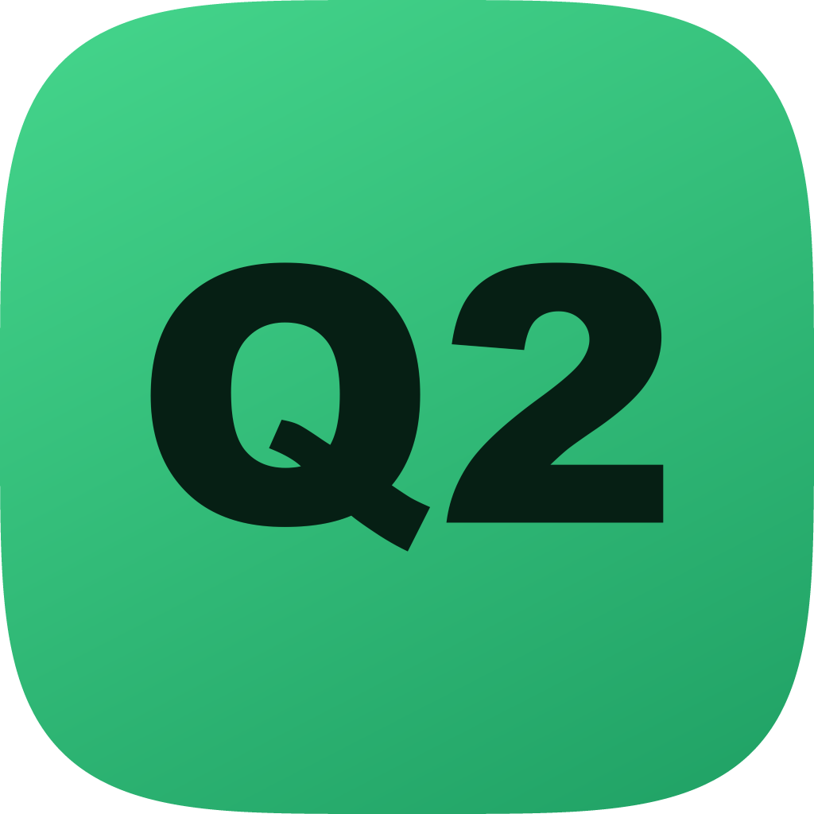

# QQ Second

<p align="center">
  
</p>

<p align="center">
  <strong>本地音乐 + QQ 音乐播放器</strong><br>
  Wails (Go + React) 桌面客户端 · Windows & macOS
</p>

QQ Second 是一个非官方 QQ 音乐桌面客户端，同时内置本地音乐库。参考
[YAQMC](https://github.com/YAQMC/YAQMC) 的功能形态与
[Pulse](https://github.com/Admirepowered/) 的 Wails 工程结构，使用 Wails v2 (Go + React + TypeScript) 重新实现。

> [!IMPORTANT]
> 本项目不 affiliated 腾讯或 QQ 音乐，不绕过订阅、地区限制或权益校验；仅播放服务方签发给当前
> 账号（或游客）的明文音频流，不实现任何加密媒体格式的解密。歌词解密仅作用于服务方下发给当前
> 用户的歌词文本。

## 功能

### QQ 音乐（游客可用，登录后增强）

- 搜索（歌曲 / 歌手 / 专辑 / 歌单）、首页推荐歌单 + 新歌速递 + 八大榜单
- 歌单 / 专辑 / 歌手详情页，一键入队连播
- 播放地址解析：`vkey.GetVkey/UrlGetVkey` 明文流，音质自动降级链（FLAC → 320k → 128k → AAC）
- 逐字歌词：QRC（3DES + zlib 解密）逐字渐变填充，整句播放期间保持高亮，翻译 / 罗马音，点击行 seek
- **扫码登录**：`ptqrshow → ptqrlogin → check_sig → oauth authorize → QQLogin`，凭据本地持久化；
  登录后可播放账号有权收听的更高音质（实测可解锁 FLAC 无损）
- **我的音乐**：收藏的歌曲（dirid=201）、我创建的歌单、收藏的歌单
- **收藏到指定歌单**：右键任意歌曲 → 收藏到歌单…（"我喜欢"或任一自建歌单），带成功/失败提示
- **听歌识曲**：录 8 秒环境音乐（或选本地音频文件）→ Shazam 指纹识别 → 自动在 QQ 音乐里找到并播放

### 本地音乐

- 文件夹管理 + 递归扫描，读取 ID3 / Vorbis / MP4 标签与内嵌封面
- 时长解析：FLAC STREAMINFO / MP3 帧头 / MP4 mvhd / WAV fmt
- `/audio/local` 原生 HTTP Range 流，seek 无级

### 播放器

- 队列（30+ 首）+ 随机 / 单曲循环 / 列表循环；无权限曲目自动跳过（连续 3 次失败停止）
- 进度条 rAF 直写 DOM；`navigator.mediaSession` → Windows SMTC 系统媒体控制
- 会话快照：重启自动恢复队列，Paused 待播

### 外观

- 深色 / 浅色 / 跟随系统，8 种主题色预设 + 自定义主色
- 背景四模式：默认 / 封面（当前曲） / 自定义图片 / 纯色
- 面板不透明度滑杆（0–100%）驱动半透明底色（不使用 backdrop-filter），背景在整个窗口可见
- 无边框窗口 + 自绘标题栏 + 托盘（零依赖 Win32 Shell_NotifyIcon）

### 通用

- 开机自启（HKCU Run 键）
- 更新检查：多通道回退（手动代理 → 域名固定 IP SNI 直连 → 系统直连）；
  Windows 一键更新（下载对应 Release 资产 → 校验替换 → 重启），macOS 下载 zip 手动安装

## 下载

前往 [Releases](https://github.com/Admirepowered/qq-second/releases/latest)：

| 平台 | 文件 |
| --- | --- |
| Windows x64 | `QQSecond-windows-amd64-<ver>.exe`（UPX 压缩，约 4–5MB，单文件免安装） |
| macOS arm64 | `QQSecond-macos-arm64-<ver>.zip`（ad-hoc 签名） |

应用内更新：设置 → 关于 → 检查更新（Windows 可一键更新）。

## 开发

```bash
# 前置：Go 1.24+、Node 20+、Wails CLI v2.12（go install github.com/wailsapp/wails/v2/cmd/wails@latest）
wails dev          # 开发模式（-browser 可在浏览器中调试）
wails build -platform windows/amd64 -ldflags "-s -w"
go run ./cmd/icon  # 重新生成品牌图标（build/appicon.png + build/windows/icon.ico）
```

发版：GitHub Actions → Build & Release → 勾选 release（可选 prerelease）。
版本号从 `internal/version/version.go` 读取；发版前**手动**改版本号并提交，CI 不做自动 bump。

## 架构

```text
React UI (zustand / 纯CSS / lucide)
   │ wailsjs 绑定 (src/api.ts)
   ▼
Go 后端 (Wails v2, 单 App 绑定)
   ├─ qqmusic/    musicu.fcg 客户端：目录接口 / vkey / QRC 歌词 / 扫码登录
   │              Android 平台流水线：随机设备 → QIMEI(RSA+AES) → GetSession
   │              zzc 签名（musics.fcg 兼容）、多通道 GitHub 访问
   ├─ 本地音乐     dhowden/tag + 自算时长
   ├─ 听歌识曲     Shazam 指纹签名（FFT + 峰值）→ amp.shazam.com → QQ 搜索映射
   ├─ AssetServer  /audio/local（Range）+ /audio/stream（签名 URL 代理）
   ├─ 托盘         自实现 Win32 Shell_NotifyIcon（无 cgo / 第三方依赖）
   └─ 设置/会话    UserConfigDir JSON 持久化
   ▼
前端 <audio>（WebView2 Chromium 解码 mp3 / m4a / flac）
```

QQ 请求协议按公开行为独立实现（设备指纹、QIMEI 申请、zzc 签名、QRC 解密均带测试向量）。

## 隐私与安全

- 登录凭据仅保存在本机 `%APPDATA%/qq-second/store.json`，不上传任何服务器
- 播放签名 URL 保留在后端，前端只拿到内部 token
- 背景图 / 封面 / 音频缓存在 `%APPDATA%/qq-second/` 下，可在文件系统直接清理
- 听歌识曲只上传音频指纹（不含可还原的原始录音），识别请求走设置里的手动代理（如已配置）

## License

仅供学习交流。使用本项目产生的一切后果由使用者自行承担。
